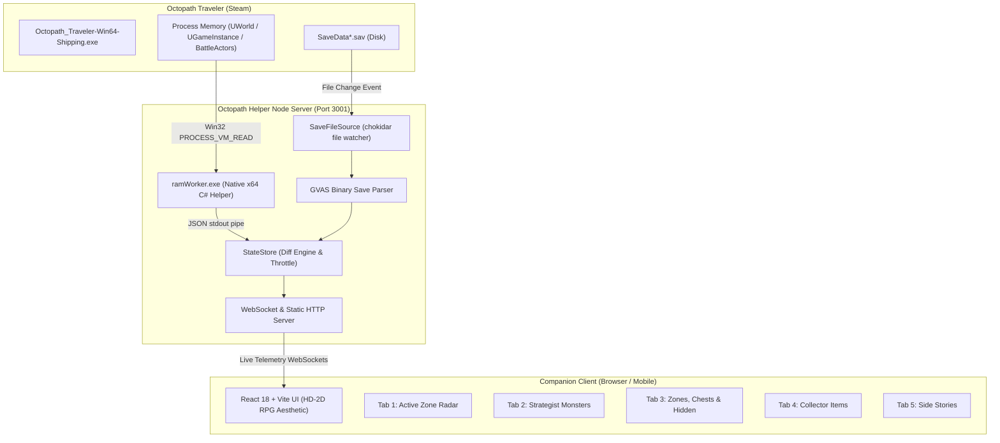

# Octopath Helper — Live Telemetry & 100% Completion Tracker (v0.1)

[](LICENSE)
[-blue.svg)](#)
[](#)
[](#)
[](#)

A zero-impact, real-time companion app and 100% completionist tracker for ***Octopath Traveler*** (PC / Steam). Built to run seamlessly on a second monitor, laptop, or mobile/tablet resting next to your controller.

---

## 🌟 Key Features

* **Real-Time Memory Telemetry (100% Read-Only):** Automatically attaches to `Octopath_Traveler-Win64-Shipping.exe`. Reads live player coordinates, party composition, and combat actors using non-invasive `PROCESS_VM_READ` Win32 APIs. Zero code injection, zero anti-cheat risk.
* **Mid-Battle Weakness Sync:** In Octopath Traveler, weakness hits during combat are held locally in actor memory and are *not* written to save files until the battle ends. Octopath Helper reads active battle actors directly, revealing weaknesses on your dashboard the split second they are struck.
* **Dynamic Zone Radar:** As you traverse the map, the dashboard instantly updates to show:
  * All treasure chests in the room (with Therion purple-chest indicators and opened/unopened status).
  * All hidden items discovered via Inquire / Scrutinize.
  * All monsters indigenous to the zone and their revealed weaknesses.
  * Side stories whose quest-givers are present in that area.
* **Point-of-No-Return Extinction Engine:** Protects 80-hour completionist runs against irreversible game-design missables. If ambient danger levels scale past 31 and permanently extinguish encounters like *Sea Birdian IV (#208)* or *Buccaneer I (#228)*, a guarded Mercy Repair feature can surgically patch the missing weakness bits into your `.sav` file (with an automatic `.bak` backup) so the legitimate Steam achievement pops.
* **100% Completionist Matrices:**
  * **Strategist:** 381 monsters with elemental and weapon vulnerability matrices.
  * **Treasure Hunter:** 734 world chests across 179 zones (including post-game Hornburg).
  * **Eagle-Eyed:** 152 hidden items.
  * **Collector:** 578 cataloged items, intelligently handling Primrose’s mutually exclusive Chapter 2 theater mask choices.
  * **Worth Your Salt:** 101 / 101 side stories mapped across all 8 world regions.
* **Couch Gaming & Mobile Ready:** Runs a unified single-port server. Open `http://localhost:3001` on your second screen or `http://<your-pc-ip>:3001` on your iPad, phone, or tablet.
* **Zero-Mouse Hotkeys:** Navigate tabs using numbers <kbd>1</kbd>–<kbd>5</kbd>, toggle live auto-follow with <kbd>F</kbd>, and defocus search with <kbd>Esc</kbd>.

---

## 🏗️ System Architecture



---

## 🚀 Quickstart & Installation

### Option 1: One-Click Launch (Recommended)
1. Download or clone this repository to your PC.
2. Double-click **`start.bat`**.
3. The script will automatically verify Node.js, install dependencies if needed, build the client bundle, boot the server, and launch your browser at `http://localhost:3001`.

### Option 2: Manual Terminal Launch
```bash
# 1. Install root dependencies
npm install

# 2. Build the client bundle
npm --prefix client install
npm --prefix client run build

# 3. Start the production server
node server/index.js
```
Open **`http://localhost:3001`** in any web browser.

---

## 🎮 Dual-Monitor Controls

| Key | Action |
| :---: | :--- |
| <kbd>1</kbd> | Switch to **Current Zone Radar** |
| <kbd>2</kbd> | Switch to **Strategist Monsters** |
| <kbd>3</kbd> | Switch to **Zones, Chests & Hidden Items** |
| <kbd>4</kbd> | Switch to **Collector Items** |
| <kbd>5</kbd> | Switch to **Side Stories (Worth Your Salt)** |
| <kbd>F</kbd> | Snap back to **Live Character Location** (Exit Inspector mode) |
| <kbd>Esc</kbd> | Clear search filters / defocus input |

---

## 🛡️ Safety & Anti-Cheat Compliance

* **Memory Access:** Uses Windows API `OpenProcess(PROCESS_VM_READ)` only. Does **not** write to game memory, inject DLLs, detour assembly instructions, or modify executable code.
* **Save File Integrity:** Save file readings are non-locking. In the event of a Point-of-No-Return Mercy Repair, a timestamped `.bak` backup file is automatically generated before any byte is altered.
* **System Footprint:** The native helper and Node server consume $\sim$23 MB RAM and 0.0% CPU during active gameplay.

---

## 📜 Development & Attributions

* **Concept, Architecture & Product Direction:** Reis
* **Implementation:** Developed using an AI-augmented agentic pair-programming workflow with **Google Antigravity** (DeepMind advanced agentic system).
* **Game Resources & Data References:** 
  * Static Excel databases adapted from the Octopath community research tables (`info.xlsx` & checklist archives).
  * Binary save structure decoded from Unreal Engine 4 GVAS specifications.

---

## 📄 License

Distributed under the **MIT License**. See [`LICENSE`](LICENSE) for more information.
